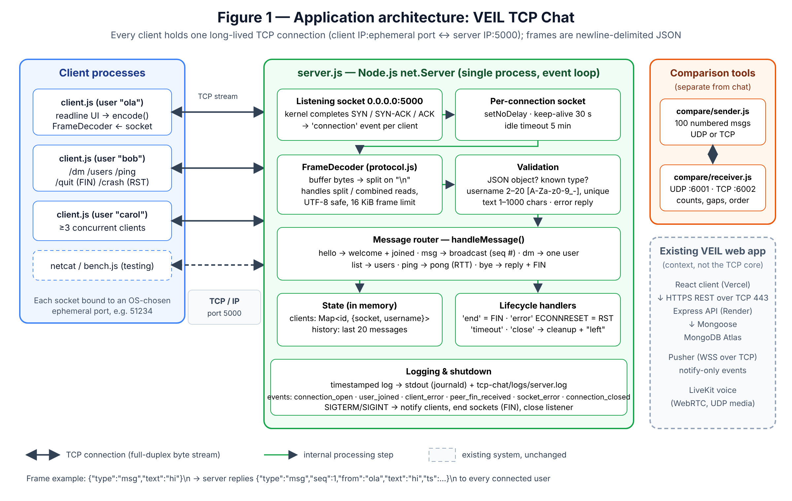

> **How to use this draft:** every `[FILL: …]` marks something only you can supply
> (your real numbers, IPs, screenshots). Replace them all, then read every section aloud
> once. You must be able to explain each sentence during the practical defence.
> Delete this box before submitting.

# 1. Introduction and Objectives

VEIL is a private community chat application that I originally built on the MERN stack
(MongoDB, Express, React, Node.js). Its web version exchanges data through HTTPS REST calls
and a third-party WebSocket service (Pusher). That works well as a product, but it hides
transport-layer behaviour: my own server never accepts or manages a socket.

For this assignment I added a **VEIL TCP Chat** module. Its core messaging uses raw TCP
sockets created with Node.js's built-in `net` module. The server accepts many concurrent
connections, frames messages itself, validates input, and handles orderly (FIN) and abrupt
(RST) disconnections. It is deployed on a Google Cloud Compute Engine virtual machine.

**Objectives**

1. Implement client–server communication using TCP sockets.
2. Show the roles of IP addresses, port numbers, connections and application-layer message framing.
3. Manage multiple concurrent users and connection lifecycle events.
4. Evaluate TCP against UDP through measurements and packet captures.
5. Deploy and validate the application on a public cloud platform, securely and at minimal cost.

**Repository:** `https://github.com/oladraxler01/discord-modified-api` (branch
`[FILL: branch name you submit, e.g. main]`), folder `tcp-chat/`.

# 2. System Requirements

## 2.1 Functional requirements

| ID | Requirement | Where it is implemented |
|---|---|---|
| F1 | Server accepts and manages multiple TCP clients | `server.js`: `net.createServer`, `clients` Map |
| F2 | Client connects using TCP | `client.js`: `net.createConnection` |
| F3 | Users identify with a unique, validated username | `hello` message, `validateUsername()` |
| F4 | Real-time text between ≥ 2 simultaneous users | `msg` broadcast |
| F5 | Group chat **and** one-to-one messaging | `msg` (group room), `dm` |
| F6 | Handle connect, disconnect and unexpected termination | `end`, `error`, `timeout`, `close` handlers; keep-alive |
| F7 | Documented message format | `tcp-chat/PROTOCOL.md` (NDJSON) |
| F8 | Explicit framing that survives split and combined reads | `FrameDecoder` in `protocol.js` |
| F9 | Malformed input never crashes the server; logs are kept | `sendError()`, try/catch per frame, `logs/server.log` |

## 2.2 Non-functional requirements

- **Portability:** Node.js ≥ 18, with zero third-party dependencies for the TCP module.
- **Security:** only the required ports are exposed and no secrets are committed (see §8.3).
- **Cost:** stays inside the cloud provider's free tier.
- **Testability:** automated tests (`npm run tcp:test`) and measurement tools you can rerun.

## 2.3 Environment

| Item | Value |
|---|---|
| Server OS | Ubuntu 24.04 LTS on GCP e2-micro (2 shared vCPU, 1 GB RAM) |
| Runtime | Node.js `[FILL: output of node -v on the VM]` |
| Client machines | `[FILL: e.g. Windows 11 laptop, Node 22; second laptop/phone]` |
| Tools | Wireshark `[FILL: version]`, tcpdump, iproute2 (`tc`, `ss`) |

# 3. System Architecture

{width=100%}

Figure 1 shows the TCP chat. It uses a **client–server** model. Each client process opens
one long-lived TCP connection to the server's well-known port **5000**. The operating
system gives the client socket an **ephemeral port** (for example 51234). The server tells
connections apart by the socket 4-tuple *(client IP, client port, server IP, server port)*.
That is why many clients can share server port 5000 at the same time.

Inside the server there is a single Node.js process. Its event loop handles all sockets
without blocking:

1. The **listening socket** (`0.0.0.0:5000`). The kernel completes the three-way handshake
   and then Node emits a `connection` event with a new **connected socket**.
2. **Per-connection settings.** `setNoDelay(true)` disables Nagle's algorithm so short chat
   lines go out immediately. `setKeepAlive(true, 30 s)` detects silently dead peers. An idle
   timeout of 5 minutes closes abandoned connections.
3. **FrameDecoder** turns the byte stream into whole messages (§4.2).
4. **Validation** and the **message router** (`handleMessage`) process each message by its `type`.
5. **Shared state.** A `Map` of connected clients and the last 20 messages.
6. **Lifecycle handlers** clean up on FIN, RST, timeout or close, and tell the remaining users.
7. **Logging** goes to stdout (captured by systemd's journal) and to `tcp-chat/logs/server.log`.

The existing VEIL web application (React on Vercel, Express on Render, MongoDB Atlas, Pusher,
LiveKit) is unchanged and shown greyed out for context. Its HTTPS and WSS traffic also runs
over TCP (port 443), but the protocol work there is done by libraries and third parties.
The TCP Chat module is where I implemented it myself.

# 4. Implementation and Message Protocol

## 4.1 Server and client

**Server (`tcp-chat/server.js`).** Key points:

```js
export const server = net.createServer((socket) => {     // called after the 3-way handshake
  const client = { id, socket, peer: `${socket.remoteAddress}:${socket.remotePort}`,
                   username: null, decoder: new FrameDecoder(), errors: 0 };
  clients.set(client.id, client);
  socket.on("data",  chunk => { for (const r of client.decoder.push(chunk)) ... });
  socket.on("end",   () => { /* peer sent FIN */  socket.end(); });
  socket.on("error", e  => { /* ECONNRESET = peer sent RST */ });
  socket.on("close", () => { clients.delete(client.id); broadcast({type:"left", ...}); });
});
server.listen(PORT, "0.0.0.0");
```

`close` is the single place where cleanup happens. It runs whether the connection ended with
FIN, RST, a timeout or a local error, so no "ghost" users are left behind. A `try/catch` around
each message handler means a bug triggered by one client can't bring down the process.
`SIGINT`/`SIGTERM` trigger a graceful shutdown: the server notifies every client,
`end()`s each socket (sending FIN) and closes the listener.

**Client (`tcp-chat/client.js`).** A terminal client using `readline`. It prints its local and
remote socket addresses when it connects, so the 4-tuple is visible during the demonstration.
Commands: plain text (group message), `/dm <user> <text>`, `/users`, `/ping` (RTT), `/quit`
(graceful, FIN) and `/crash` (abrupt: `socket.resetAndDestroy()` sends a TCP RST). Anything
typed before the server accepts the username is queued and sent after the `welcome` reply.

## 4.2 Why framing is needed, and how it works

TCP delivers an **ordered, reliable byte stream** and keeps no record of where one `write()`
ends and the next begins. A single `write()` can arrive in several `data` events: it may be
split across segments by the MSS, or the receiver may read before everything has arrived.
Several writes can also arrive together in one `data` event (Nagle's algorithm, delayed ACKs,
or the receiver reading late). Treating each `data` event as one message would therefore
corrupt messages at random.

I use **newline-delimited JSON (NDJSON)**. Every message is one JSON object followed by `\n`.
`JSON.stringify` escapes any newline inside a string as the two characters `\` `n`, so a raw
`0x0A` byte can only mean "end of frame".

```js
push(chunk) {
  this.buffer += this.decoder.write(chunk);        // StringDecoder: keeps split UTF-8 chars intact
  while ((i = this.buffer.indexOf("\n")) !== -1) {
    const raw = this.buffer.slice(0, i);
    this.buffer = this.buffer.slice(i + 1);        // keep any remainder for the next read
    results.push(tryParse(raw));                    // { message } or { error }
  }
  if (bytes(this.buffer) > 16 KiB) → fatal "Frame too large"   // memory-exhaustion guard
}
```

Edge cases this handles, all covered by automated tests (§6): a frame split across reads, a
frame delivered **one byte at a time**, several frames in one read, 1.5 frames followed by the
rest, an emoji whose 4 UTF-8 bytes are split across reads, CRLF line endings, invalid JSON
(the frames after it still parse) and an oversized line.

I chose NDJSON over length-prefixing because it is human-readable in Wireshark's "Follow TCP
Stream" and can be typed by hand with `nc`. Length-prefixed binary framing would be more
efficient and wouldn't need escaping, but it is harder to debug.

## 4.3 Message format

Full specification: `tcp-chat/PROTOCOL.md`. Summary:

| Direction | `type` | Fields |
|---|---|---|
| C→S | `hello` | `username` (2–20 chars `[A-Za-z0-9_-]`, unique ignoring case) |
| C→S | `msg` / `dm` | `text` (1–1000 chars), `to` (for `dm`) |
| C→S | `list`, `ping`, `bye` | `ping` carries `t`, which the server echoes |
| S→C | `welcome` | `username`, `connectionId`, `client{ip,port}`, `server{ip,port}`, `users[]`, `history[]` |
| S→C | `msg` | `seq` (server order number), `from`, `text`, `ts` |
| S→C | `joined` / `left` | `username`, `reason` (`quit`, `closed`, `connection_reset`, `timeout`) |
| S→C | `users`, `pong`, `bye`, `error` | `error` has `code` and `message` |

Example exchange (exactly what appears in "Follow TCP Stream"):

```
C→S {"type":"hello","username":"ola"}
S→C {"type":"welcome","username":"ola","connectionId":1,"client":{"ip":"…","port":51234},"server":{"ip":"10.128.0.2","port":5000},"users":["ola"],"history":[]}
C→S {"type":"msg","text":"hi"}
S→C {"type":"msg","seq":1,"from":"ola","text":"hi","ts":1764107000000}
C→S {"type":"bye"}
S→C {"type":"bye"}
```

## 4.4 Validation, error handling and logging

| Bad input | Server response |
|---|---|
| Not JSON / not an object | `error malformed`; the connection stays open |
| Any message before `hello` | `error not_identified` |
| Invalid or duplicate username | `error invalid_username` / `username_taken` |
| Empty or > 1000-char text | `error invalid_text` |
| Unknown `type` | `error unknown_type` |
| 10 errors on one connection | `error too_many_errors`, then FIN |
| Line > 16 KiB without `\n` | `error malformed`, then FIN |

Sample log lines (`[FILL: replace with lines from your own server.log]`):

```
2026-11-25T21:57:43.302Z [INFO] connection_open {"id":1,"peer":"127.0.0.1:33752","local":"127.0.0.1:5055","total":1}
2026-11-25T21:57:43.303Z [INFO] user_joined {"id":1,"peer":"127.0.0.1:33752","username":"bob"}
2026-11-25T21:57:45.580Z [INFO] peer_fin_received {"id":1,"username":"bob"}
2026-11-25T21:57:45.581Z [INFO] connection_closed {"id":1,"peer":"127.0.0.1:33752","username":"bob","reason":"quit","total":1}
2026-11-25T21:57:46.081Z [WARN] socket_error {"id":2,"username":"ola","code":"ECONNRESET"}
2026-11-25T21:57:46.081Z [INFO] connection_closed {"id":2,"peer":"127.0.0.1:33762","username":"ola","reason":"connection_reset","total":0}
```

# 5. TCP versus UDP Analysis

## 5.1 Question 1 — Why is TCP suitable for normal chat messages?

Chat text has to arrive **complete, exactly once and in order**. If "Meet at 5" and "Actually, 6"
arrived swapped, or one went missing, the conversation would be wrong. TCP gives these
properties without any extra application code. Chat traffic is also small and
latency-tolerant: a few extra milliseconds, or around 200 ms during a retransmission, is
barely noticeable to a person, unlike in voice. A connection also gives the server a natural
notion of "who is online": a user is present while their socket is open. My server relies on
that for `joined`/`left` notifications. TCP's flow and congestion control protect slow
clients and shared networks automatically.

## 5.2 Question 2 — What transport-layer guarantees does TCP provide?

- **Connection-oriented communication:** the three-way handshake (SYN, SYN-ACK, ACK) agrees on
  initial sequence numbers and options (MSS, window scaling, SACK) before data flows (Experiment 1).
- **Reliable delivery:** each byte has a sequence number. The receiver acknowledges with
  cumulative ACKs (plus SACK blocks). Lost segments are retransmitted after duplicate ACKs (fast
  retransmit) or a retransmission timeout (RTO) (Experiment 2).
- **In-order delivery and no duplicates:** out-of-order segments are buffered and duplicates
  discarded, so the application reads bytes exactly in the order they were sent.
- **Error detection:** a 16-bit checksum over header and data. Corrupted segments are dropped and later resent.
- **Flow control:** the receiver advertises a receive window (rwnd), so a fast sender can't overflow a slow receiver's buffer (Experiment 4).
- **Congestion control:** the congestion window (cwnd) is adjusted (slow start, congestion
  avoidance, e.g. CUBIC on Linux) to avoid overloading the network.
- **Full-duplex communication and orderly release:** each direction closes independently with FIN/ACK (Experiment 3).

TCP does **not** guarantee message boundaries, a delivery deadline, or that data was processed
by the remote application (§5.9).

## 5.3 Question 3 — Major differences between TCP and UDP

| Property | TCP | UDP |
|---|---|---|
| Connection | Connection-oriented (handshake, teardown) | Connectionless |
| Reliability | ACKs and retransmission | None: best effort |
| Ordering | Guaranteed | Not guaranteed |
| Data unit | Byte stream (no boundaries) | Datagram (boundaries preserved) |
| Flow / congestion control | Yes (rwnd, cwnd) | No |
| Header size | 20–60 bytes | 8 bytes |
| Latency under loss | Higher (waits for retransmission: head-of-line blocking) | Unaffected (lost data simply never arrives) |
| Delivery pattern | Unicast | Unicast, broadcast, multicast |
| Typical uses | Web (HTTP/1.1, HTTP/2), e-mail, SSH, file transfer, chat | DNS, VoIP, video calls, gaming, streaming; QUIC is built on it |

In my implementation the difference shows up directly in the code. The TCP comparison sender
needs `FrameDecoder` because it is a stream. The UDP sender sends one JSON object per
`socket.send()` and the receiver gets exactly one datagram per message, so no framing is needed.

## 5.4 Question 4 — Which parts of a chat application could reasonably use UDP?

Data that is **time-sensitive and replaceable**, where a late copy is worthless and the next
update replaces it:

- **Voice and video calls.** The existing VEIL app already does this: LiveKit carries media
  with WebRTC over UDP (RTP/SRTP). A retransmitted audio frame would arrive too late to play.
- **Typing indicators and presence ("online", "is typing…").** If one is lost, the next update corrects it.
- **Live location or cursor positions, read receipts for non-critical UI, and LAN service discovery.**

Message text, files, login and membership changes must stay on TCP, or on a reliable protocol
built on UDP such as QUIC.

## 5.5 Question 5 — What happens if a UDP message is lost or arrives out of order?

Nothing at the transport layer. UDP has no sequence numbers or ACKs, so the sender is never
told and the datagram is gone. Out-of-order datagrams are passed to the application in the
order they arrive. Any recovery must be built by the application: sequence numbers to detect
gaps and reordering (as my comparison receiver does: `missing[]`, `outOfOrder`), timeouts and
retransmission, or forward error correction. My measurements under `[FILL: 10]`% emulated loss
showed `[FILL: N]`/100 UDP messages received with missing sequence numbers `[FILL: list]`,
and no recovery. TCP delivered `[FILL: 100]`/100 in order over the same impaired link (§7.5).

## 5.6 Question 6 — How do sockets and port numbers enable process-to-process communication?

An **IP address** identifies a host interface, and routers use it to deliver packets
host-to-host. The **port number** (16 bits in the TCP/UDP header) identifies a *process* on that
host: transport-layer multiplexing and demultiplexing. A **socket** is the operating-system
endpoint that a process uses to send and receive, bound to (IP, port).

In my system the server process calls `listen(5000)`, so the kernel delivers every segment
arriving for port 5000 to it. Each client's kernel picks a free ephemeral port
(`[FILL: e.g. 51234]` in my capture). After `accept`, the server holds one connected socket per
client, identified by the 4-tuple, for example
`([FILL: client public IP], [FILL: client port]) ↔ (10.128.0.2, 5000)`. A TCP connection is
demultiplexed by the full 4-tuple, so ten clients can all talk to port 5000 at once. A UDP
socket is demultiplexed by destination port only. The `welcome` message reports both endpoints
back to the client, so the 4-tuple can be read live during the demonstration. On GCP the server
sees its internal address (10.128.x.x): the VM's external IP is translated by Google's 1:1 NAT.

## 5.7 Question 7 — What happens when a client disconnects while using TCP?

- **Graceful disconnect (`/quit`, Ctrl+C):** the client sends a `bye` frame. The server replies,
  then both sides exchange **FIN → ACK, FIN → ACK** (a four-way close; FIN and ACK are often
  combined as `FIN, ACK`). Node emits `end` and then `close`. The server removes the user and
  broadcasts `left (quit)`. The side that closes first enters **TIME_WAIT** (2×MSL) so late
  duplicate segments can't be mistaken for a new connection.
- **Abrupt termination (process killed, `/crash`):** the client's OS sends **RST** instead of
  FIN. The server gets `ECONNRESET`, logs `connection_reset` and runs the same cleanup. Any
  unread data is discarded.
- **Silent failure (cable pulled, Wi-Fi lost, laptop sleeps):** no FIN and no RST are sent, so
  the server can't know right away. The connection is only declared dead when (a) the server
  tries to send and its retransmissions time out, (b) TCP keep-alive probes go unanswered
  (enabled after 30 s idle), or (c) my application idle timeout (5 min) fires.

Evidence: Experiment 3 (§7.3).

## 5.8 Why TCP needs application-level message framing

As explained in §4.2, TCP's service is a byte stream. Segment boundaries depend on MSS,
Nagle's algorithm, congestion state and when the receiver reads, not on the application's
`write()` calls. The tests in §6 show one message split across reads and several messages in
one read. Without a delimiter or length prefix the receiver can't know where a message ends.

## 5.9 What TCP cannot guarantee after a connection failure

- **Delivery to the application.** An ACK only means the remote *kernel* received the bytes.
  If the server crashes after ACKing but before processing, the message is lost even though
  the client saw it acknowledged.
- **Knowing which data arrived.** After a reset or timeout the sender can't tell which of its
  last writes were processed. `write()` succeeding only means the data was copied into the local send buffer.
- **Timely detection.** A silent peer is only noticed after keep-alive or retransmission timeouts (from seconds up to about 15 minutes by default on Linux).
- **Continuity.** A new connection is a new byte stream. TCP doesn't resume or replay. My client
  must reconnect and send `hello` again. The server's last-20-messages history partly makes up
  for this, but there are no end-to-end acknowledgements or exactly-once guarantees (see
  Limitations).

## 5.10 How the packet captures support these conclusions

| Claim | Evidence |
|---|---|
| Connection set up by a three-way handshake with random ISNs | Exp 1 capture: SYN / SYN-ACK / ACK, seq/ack values (§7.1) |
| Lost segments are retransmitted with the same sequence number | Exp 2: `tcp.analysis.retransmission` packets (§7.2) |
| Graceful close = FIN exchange; crash = RST | Exp 3 captures and server log (§7.3) |
| Receiver advertises a window; RTT dominates chat performance | Exp 4: window column, `ss -tin`, bench results (§7.4) |
| UDP gives no recovery; TCP does at a latency cost | Comparison table and capture (§7.5) |
| Messages don't line up with segments | Exp 2/4: one TCP segment containing several `\n`-terminated frames (`[FILL: packet number]`) |

# 6. Testing and Results

## 6.1 Automated tests (`npm run tcp:test`)

| # | Test | Result |
|---|---|---|
| 1 | One complete frame in one read | ✅ Pass |
| 2 | One frame split across multiple reads | ✅ Pass |
| 3 | Frame delivered one byte at a time | ✅ Pass |
| 4 | Several frames combined in a single read | ✅ Pass |
| 5 | 1.5 frames, then the rest | ✅ Pass |
| 6 | Multi-byte UTF-8 (emoji) split across reads | ✅ Pass |
| 7 | Malformed JSON reported; later frames still parse | ✅ Pass |
| 8 | CRLF line endings accepted | ✅ Pass |
| 9 | Oversized frame rejected as fatal | ✅ Pass |
| 10 | Three simultaneous clients exchange group and DM messages | ✅ Pass |
| 11 | Client reconnects while others stay connected | ✅ Pass |
| 12 | Abrupt termination (RST) detected and cleaned up | ✅ Pass |
| 13 | Malformed input and invalid values don't crash the server | ✅ Pass |
| 14 | Frames split across real TCP writes and combined in one write | ✅ Pass |

Total: **14 passed, 0 failed** (Node.js 22). `[FILL: paste a screenshot of the npm run tcp:test output from your machine]`

## 6.2 Manual and cloud tests

See the full test log in `docs/TEST_LOG.md`. Summary: `[FILL: e.g. 3 clients on 2 networks, reconnect, malformed via netcat, all passed]`.

# 7. Compulsory TCP Investigations

All captures are in `tcp-chat/experiments/captures/`. Commands are in
`tcp-chat/experiments/EXPERIMENTS.md`, and exact command lines are in Appendix A. Captures use
test usernames and test text only.

## 7.1 Experiment 1 — Connection establishment

**Setup:** server and client both on my Windows laptop, using the loopback interface
(127.0.0.1). The capture was taken in Wireshark 4.6.10 on "Adapter for loopback traffic capture"
(Npcap), with display filter `tcp.port == 5000` and relative sequence numbers turned off, so the
real ISNs are shown. File: `exp1-handshake.pcapng`.
`[FILL: if you get a cloud VM, repeat this over the Internet and add a second table]`

`[FILL: Screenshot — Wireshark packet list, packets 53–55 highlighted]`
`[FILL: Screenshot — packet 53 details, Transmission Control Protocol expanded]`

| Pkt | Source → Destination | Flags | Seq (raw) | Ack (raw) | Win | Notes |
|---|---|---|---|---|---|---|
| 53 | 127.0.0.1:**16414** → 127.0.0.1:**5000** | SYN | **282152160** (client ISN *x*) | 0 | 65535 | Options: MSS=65495, WS=256 (×256), SACK_PERM |
| 54 | 127.0.0.1:5000 → 127.0.0.1:16414 | SYN, ACK | **1135857521** (server ISN *y*) | 282152161 (*x*+1) | 65535 | Server's own MSS, WS and SACK |
| 55 | 127.0.0.1:16414 → 127.0.0.1:5000 | ACK | 282152161 (*x*+1) | 1135857522 (*y*+1) | 327424 | Handshake done: ESTABLISHED |

**Explanation:** the client process was given ephemeral port **16414** by Windows and connected
to the server's well-known port **5000**. Together the two IP:port pairs form the connection's
4-tuple. The client chose a random initial sequence number x = 282152160. The server replied
with its own random ISN y = 1135857521 and acknowledged x+1: a SYN uses up one sequence number
even though it carries no data (Len=0). The third packet acknowledges y+1, and both sides then
consider the connection established. The whole handshake took about 0.25 ms on loopback
(40.661066 s → 40.661317 s).

The SYN also negotiated options:
- **MSS = 65495:** the largest segment the receiver accepts. This is the loopback MTU of 65535 minus 40 bytes of IP and TCP headers.
- **Window scale = 256:** the 16-bit window field is multiplied by 256. That's why packet 55's `Win=327424` (= 1279 × 256) is larger than 65535.
- **SACK permitted:** selective acknowledgements are allowed.

**The rest of the same capture shows framing and the connection lifecycle:**

| Pkt | Direction | Len (bytes) | Content (Follow TCP Stream) |
|---|---|---|---|
| 56 | client → server | 34 | `{"type":"hello","username":"ola"}` + `\n` (33 + 1) |
| 58 | server → client | 163 | `welcome` frame |
| 92 | client → server | 39 | `{"type":"msg","text":"hello from ola"}` + `\n` |
| 94 | server → client | 79 | broadcast `msg` with `seq: 1` |
| 122–123 | server ↔ client | 1 / 0 | **TCP Keep-Alive** probe and ACK, 30 s after the last data. This is my `socket.setKeepAlive(true, 30000)` working |
| 132 / 134 | both | 15 / 15 | `{"type":"bye"}` + `\n` and the server's reply |
| 136–139 | both | 0 | FIN,ACK → ACK → FIN,ACK → ACK: the graceful four-way close (see §7.3) |

Each `Len` matches the byte length of one JSON object plus its `\n` delimiter, and every data
segment is acknowledged by the receiver. Packet 57 (server) has Ack = 282152161 + 34 = 282152195,
and packet 59 (client) has Ack = 1135857522 + 163 = 1135857685. That is TCP's cumulative acknowledgement counting bytes,
not messages. In this capture each frame happened to fit in its own segment. Experiment 2/4
shows cases where they don't.

## 7.2 Experiment 2 — Packet loss and retransmission

**Setup:** server and `bench.js` both on the VM over loopback, with `tc netem loss
[FILL: 10]%`. Loss was applied only to the loopback interface of my own VM.

`[FILL: Screenshot — filter tcp.analysis.retransmission || tcp.analysis.duplicate_ack]`
`[FILL: Optional screenshot — Stevens graph showing a stall]`

| Metric | No loss | `[FILL: 10]`% loss |
|---|---|---|
| Messages delivered (bench) | `[FILL]`/`[FILL]` | `[FILL]`/`[FILL]` |
| Retransmissions in capture (Statistics → Expert Info) | `[FILL]` | `[FILL]` |
| RTT avg / p95 / max (ms) | `[FILL]` | `[FILL]` |

**Explanation:** `[FILL: describe one specific retransmission. Example: "Packet 214 is a
retransmission of packet 198 (same Seq=1234, Len=60). Packets 201–203 are duplicate ACKs
with Ack=1234, so the sender used fast retransmit. Packet 260 shows an RTO retransmission
about 210 ms after the original because no duplicate ACKs came back."]` Every message was still
delivered in order. The cost of reliability is the latency spike seen in max/p95. This is
head-of-line blocking: later messages wait in the receive buffer until the missing segment arrives.

## 7.3 Experiment 3 — Connection termination

**Setup:** loopback on my laptop, Wireshark on the Npcap loopback adapter, filter
`tcp.port == 5000`. Captures: `exp1-handshake.pcapng` (client-initiated graceful close) and
`exp3-termination.pcapng` (server-initiated graceful close, then an abrupt client crash).

`[FILL: Screenshot A — exp3 packet list showing packets 178–183 (FIN) and 320 (RST)]`
`[FILL: Screenshot B — server terminal log for both cases]`

**Case 1: graceful close started by the client (`/quit`), from `exp1-handshake.pcapng`**

| Pkt | Direction | Flags | Meaning |
|---|---|---|---|
| 132 | client → server | PSH, ACK, Len=15 | `{"type":"bye"}\n` |
| 134 | server → client | PSH, ACK, Len=15 | server replies `bye`, then calls `socket.end()` |
| 136 | server → client | **FIN, ACK** | server has no more data to send |
| 137 | client → server | ACK | acknowledges the server's FIN |
| 138 | client → server | **FIN, ACK** | client closes its direction too |
| 139 | server → client | ACK | connection fully closed |

**Case 2: graceful close started by the server (Ctrl+C → SIGTERM/SIGINT handler), `exp3-termination.pcapng`, client "normal" on port 1348**

| Pkt | Direction | Flags | Meaning |
|---|---|---|---|
| 178 | server → client | PSH, ACK, Len=79 | `{"type":"error","code":"server_shutdown",…}` |
| 180 | server → client | **FIN, ACK** | server's `socket.end()` |
| 181 | client → server | ACK | |
| 182 | client → server | **FIN, ACK** | client prints "Server closed the connection (FIN received)" |
| 183 | server → client | ACK | |

Server log: `shutdown {"signal":"SIGINT","clients":1}`, then `peer_fin_received {"username":"normal"}`.

**Case 3: abrupt termination (`/crash` = `socket.resetAndDestroy()`), same capture, client "crasher" on port 1462**

| Pkt | Direction | Flags | Meaning |
|---|---|---|---|
| 283–285 | both | SYN / SYN, ACK / ACK | new connection (new ephemeral port 1462) |
| 286 | client → server | PSH, ACK, Len=38 | `{"type":"hello","username":"crasher"}\n` |
| 288 | server → client | PSH, ACK, Len=170 | `welcome` |
| **320** | client → server | **RST, ACK** | the connection is torn down immediately: no FIN and no reply expected |

Server log (real output):

```
2026-11-26T11:39:01.671Z [WARN] socket_error {"id":1,"username":"crasher","code":"ECONNRESET"}
2026-11-26T11:39:01.690Z [INFO] connection_closed {"id":1,"peer":"127.0.0.1:1462","username":"crasher","reason":"connection_reset","total":0}
```

**Comparison**

| | Graceful (FIN) | Abrupt (RST) |
|---|---|---|
| Packets | 4 (FIN, ACK, FIN, ACK). Each direction is closed separately (half-close) | 1 (RST). Both directions die at once |
| Data in flight | Delivered first: FIN comes *after* all data (e.g. `bye` and `server_shutdown` arrived before the FIN) | Any unsent or unread data is discarded |
| Server event | `'end'` → `peer_fin_received` → `'close'` | `'error'` with `ECONNRESET` → `'close'` |
| Logged reason | `quit` / `closed` | `connection_reset` |
| TIME_WAIT | Yes, on the side that sent the first FIN (here the server, packets 136 and 180), for 2×MSL | No: RST skips TIME_WAIT |

**Server-side cleanup:** in all three cases the `'close'` handler ran. It removed the client
from the `clients` Map (so the username can be reused), logged the reason and broadcast `left` to
the remaining users. `total` dropped back to 0 in the log, so no connection state was leaked.

**Keep-alive (bonus observation):** packets 82/83, 124/125 and 162/163 are `[TCP Keep-Alive]`
probes from the server (port 5000) exactly 30 s apart while the "normal" client was idle, each
answered by a `[TCP Keep-Alive ACK]`. This is `socket.setKeepAlive(true, 30000)`. If the client
had disappeared silently (Wi-Fi off, no FIN and no RST), these probes would go unanswered and the
OS would eventually report the connection dead. That is the only way the server can detect that case.

## 7.4 Experiment 4 — Flow control and performance

| Condition | RTT avg (ms) | RTT p95 (ms) | Throughput (msg/s) | KB/s sent |
|---|---|---|---|---|
| A — loopback on VM | `[FILL]` | `[FILL]` | `[FILL]` | `[FILL]` |
| B — laptop → GCP over Internet | `[FILL]` | `[FILL]` | `[FILL]` | `[FILL]` |
| C (optional) — loopback + 100 ms netem delay | `[FILL]` | `[FILL]` | `[FILL]` | `[FILL]` |

`[FILL: Screenshot — Wireshark with tcp.window_size column / Window Scaling graph]`
`[FILL: paste ss -tin output: rtt, cwnd, rcv_space, snd_wnd]`

**Explanation:** the window scale factor negotiated in the SYN was `[FILL]`, so the advertised
receive window was about `[FILL]` bytes. The window `[FILL: stayed large / shrank to X during the
burst]`, showing the receiver had buffer space, so flow control `[FILL: did / did not]` limit the
sender. Throughput in B is much lower than in A because each ping must wait one network RTT
(`[FILL]` ms vs `[FILL]` ms), and the burst test is limited by cwnd growth (slow start) over a
long-RTT path. For small chat messages, latency is set by RTT, not bandwidth.

## 7.5 TCP versus UDP practical comparison

**Method:** `tcp-chat/compare/run-all.sh` on the VM over loopback. 100 numbered messages,
20 ms apart, sent with each protocol, first at baseline and then with `tc netem loss
[FILL: 10]%`. The receiver echoes each message, so the sender measures RTT with one clock.

`[FILL: paste tcp-chat/compare/results/RESULTS.md table here]`

| Condition | Protocol | Sent | Received | Loss % | Missing | Out of order | RTT avg | RTT max |
|---|---|---|---|---|---|---|---|---|
| baseline | TCP | 100 | `[FILL]` | | | | | |
| baseline | UDP | 100 | `[FILL]` | | | | | |
| loss`[FILL]` | TCP | 100 | `[FILL]` | | | | | |
| loss`[FILL]` | UDP | 100 | `[FILL]` | | | | | |

**Discussion:** `[FILL: e.g. "At baseline both protocols delivered 100/100. Under 10% loss UDP
delivered 91/100 (missing 7, 22, …) with no retransmission and an almost unchanged RTT. TCP
delivered 100/100 in order, but its maximum RTT rose from 0.6 ms to 212 ms because of
retransmission timeouts."]`

**What the results do and don't prove:**

- They *show* that under random loss UDP loses data with no recovery and TCP recovers at a latency cost.
- They *don't* prove behaviour on real congested networks. netem drops packets at random and
  independently, whereas real loss comes in bursts and is related to queues.
- 100 messages is a small sample. The loss rate measured will differ from the configured rate (e.g. 9% vs 10%).
- Loopback almost never reorders packets, so seeing no UDP reordering does **not** mean UDP preserves order.
- UDP RTT counts loss in both directions, because the echo can also be lost. The receiver's count is the one-way figure.

# 8. Cloud Deployment

{width=100%}

## 8.1 Services selected and why

| Service | Why |
|---|---|
| **Google Compute Engine VM (e2-micro, us-central1)** | A raw TCP service needs a host with a public IP and full control of arbitrary ports. PaaS options (Cloud Run, App Engine, Render, Vercel) only route HTTP(S) and wouldn't carry port 5000. Root access is also needed for tcpdump and tc. e2-micro is in the Always Free tier. |
| **VPC firewall rules** | A stateful network-level filter in front of the VM. It allows exactly the ports needed. |
| **Ephemeral external IP** | Free while attached to a running VM. A reserved static IP costs money when idle. |
| **systemd** | Starts the server on boot, restarts it on crash, and sends SIGTERM for a graceful stop. |
| **Cloud Billing budget** | Spending alert in case of an accidental charge. |

**Public endpoint:** host `[FILL: EXTERNAL-IP]`, port **5000/TCP**. This is a raw TCP
service, not an HTTP URL. Connect with:

```bash
node tcp-chat/client.js --host [FILL: EXTERNAL-IP] --port 5000 --name <yourname>
```

## 8.2 Provisioning and deployment steps

Summary (full commands in `tcp-chat/deploy/DEPLOY.md`):

1. Create a GCP project, enable billing and Compute Engine, and set a $1 budget alert.
2. Create the VM: `veil-tcp`, e2-micro, us-central1-a, Ubuntu 24.04, 10 GB standard disk, network tag `veil-chat`.
3. Firewall: allow `tcp:5000` from `0.0.0.0/0`, and `tcp:22` from `[FILL: your IP]/32` only. Delete `default-allow-ssh`.
4. SSH in, install Node.js 22 and git, create the unprivileged user `veil`, and clone the repository.
5. Install `veil-tcp-chat.service`, then run `systemctl enable --now veil-tcp-chat`.
6. Verify with `ss -ltnp 'sport = :5000'` and connect two clients from different networks.

| Operation | Command |
|---|---|
| Start / stop / restart | `sudo systemctl start` / `stop` / `restart veil-tcp-chat` |
| Logs | `journalctl -u veil-tcp-chat -f`, `tcp-chat/logs/server.log` |
| Update | `git pull`, then `sudo systemctl restart veil-tcp-chat` |
| Change port | `systemctl edit` → `Environment=TCP_PORT=6000`, restart, and add a matching firewall rule |
| Cleanup | Delete the VM and the firewall rules, then check that billing shows $0 |

**Evidence of two users:** `[FILL: Screenshot — two terminals on different networks
exchanging messages through EXTERNAL-IP:5000]` `[FILL: Screenshot — journalctl showing both
connection_open lines with different peer IPs]`

## 8.3 Security

- **Exposure:** only TCP 5000 is open to the Internet. SSH (22) is restricted to my IP and uses
  key-based login. Everything else is blocked by the VPC's implied deny-ingress rule.
  `[FILL: screenshot of firewall rules page]`
- **Least privilege:** the server runs as the unprivileged user `veil` with `NoNewPrivileges`.
  Port 5000 is above 1024, so no root is needed.
- **Secrets:** the TCP module needs no secrets. Its configuration (`TCP_PORT`, `TCP_HOST`) is set
  through environment variables in the systemd unit. The VEIL web API reads MongoDB, Pusher,
  Firebase and LiveKit credentials from environment variables on Render. `.env` files are
  git-ignored and a `.env.example` documents the names. Credentials that appeared in early Git
  history have been `[FILL: rotated]`.
- **Input hardening:** size limits (16 KiB frame, 1000-char text), validation, an error budget per connection and a crash-proof handler.
- **TLS:** the TCP chat is **not** encrypted. This was deliberate, so that framing and
  handshakes are visible in packet captures for this assignment. The limitation is that anyone
  on the network path could read or change messages. For production I would wrap the socket in
  TLS (`tls.createServer` with a certificate, or a TLS-terminating proxy) and use TLS 1.3.
  The VEIL web application is already served over HTTPS/WSS.

## 8.4 Cost

| Resource | Free-tier allowance | My usage | Cost |
|---|---|---|---|
| e2-micro VM (us-central1) | 1 instance-month | 1 instance | $0 |
| Standard persistent disk | 30 GB-month | 10 GB | $0 |
| Network egress | 1 GB/month (excluding China and Australia) | < `[FILL]` MB | $0 |
| Ephemeral external IP (in use) | `[FILL: check the current GCP pricing page — external IPv4 may be charged]` | 1 | `[FILL]` |

**Estimated total: `[FILL: $0.00 – about $3]` per month.** A budget of $1 with alerts at 50/90/100%
was configured on `[FILL: date]`. Resources will be deleted after grading.

# 9. Challenges and Limitations

**Challenges**

- Recognising that the original VEIL design (REST plus a third-party WebSocket service) could not
  show transport-layer handling, and adding a dedicated TCP layer without breaking the existing app.
- Framing edge cases: a multi-byte UTF-8 character split across reads corrupted text until I used `StringDecoder`.
- Telling the three disconnect cases apart (FIN, RST, silent) and making cleanup run in exactly one place.
- `[FILL: anything that went wrong for you during deployment or experiments, e.g. the netem kernel module missing on the GCP image]`

**Limitations**

1. **No encryption or authentication** on the TCP chat. Usernames aren't verified (anyone can
   claim any free name). The VEIL web app uses Firebase authentication, but the TCP module does not.
2. **In-memory state:** history and users are lost on restart, and a single process can't scale horizontally.
3. **No end-to-end acknowledgements:** if a connection fails, a client can't know which of its last messages were broadcast (§5.9).
4. **The client doesn't reconnect automatically.** Reconnection is manual (run it again and rejoin).
5. **Experiments use emulated loss and delay** on loopback, and a small sample size (§7.5).
6. **Single region and VM.** There is no load balancer or redundancy. If the VM goes down, the service is unavailable.
7. The browser UI isn't connected to the TCP chat. The demonstration client is a terminal client.

# 10. Conclusion

The VEIL TCP Chat shows the transport layer at work. Each user is a TCP connection identified
by IP addresses and ports. The server multiplexes many clients on port 5000. Newline-delimited
JSON framing turns TCP's byte stream into discrete messages. Connection lifecycle events (FIN,
RST, timeouts) are detected and cleaned up reliably. The packet captures confirmed the
three-way handshake, retransmission under loss, and the difference between graceful and abrupt
termination. The UDP comparison showed TCP trading latency for reliability and ordering, which
suits chat text, while UDP fits real-time, replaceable data such as voice, which VEIL already
carries over WebRTC. The system runs on a free-tier Google Cloud VM with only the required ports
exposed.

# 11. References

1. W. Eddy (ed.), *RFC 9293: Transmission Control Protocol (TCP)*, IETF, 2022.
2. J. Postel, *RFC 768: User Datagram Protocol*, IETF, 1980.
3. V. Paxson, M. Allman, J. Chu, M. Sargent, *RFC 6298: Computing TCP's Retransmission Timer*, IETF, 2011.
4. D. Borman, B. Braden, V. Jacobson, R. Scheffenegger, *RFC 7323: TCP Extensions for High Performance*, IETF, 2014.
5. I. Fette, A. Melnikov, *RFC 6455: The WebSocket Protocol*, IETF, 2011.
6. J. F. Kurose, K. W. Ross, *Computer Networking: A Top-Down Approach*, 8th ed., Pearson, 2021, ch. 3.
7. Node.js documentation, "net — TCP" and "dgram — UDP", https://nodejs.org/api/
8. Linux man page `tc-netem(8)`; Wireshark User's Guide, https://www.wireshark.org/docs/
9. Google Cloud, "Free cloud features and trial offer", https://cloud.google.com/free/docs/free-cloud-features

# Appendix A — Key commands

```bash
# Run and test
npm run tcp:server
npm run tcp:test
node tcp-chat/client.js --host <EXTERNAL-IP> --port 5000 --name ola

# Captures (on VM)
sudo ./tcp-chat/experiments/capture.sh exp1-handshake "tcp port 5000"
sudo ./tcp-chat/experiments/netem.sh loss 10      # ... then: netem.sh clear
node tcp-chat/bench.js --host 127.0.0.1 --port 5000 --label A-loopback
./tcp-chat/compare/run-all.sh
node tcp-chat/compare/summarize.js
ss -tin 'sport = :5000'
```

`[FILL: paste the exact command lines you ran, with timestamps if possible]`

# Appendix B — Screenshots

`[FILL: any additional screenshots that do not fit above]`
