# 1. Introduction and Objectives

VEIL is a chat application I originally built on the MERN stack. Its web version sends messages
through HTTPS requests and a third-party real-time service (Pusher), so my own server never
handles a network connection directly. For this assignment I added **VEIL TCP Chat**: a
multi-user chat whose core messaging uses **raw TCP sockets** (Node.js `net` module). It is
tested with Wireshark and deployed publicly on Render.

**Objectives:**

1. Implement client–server communication with TCP sockets.
2. Show the roles of IP addresses, ports, connections and message framing.
3. Handle many users and the connection lifecycle (connect, quit, crash).
4. Compare TCP with UDP using measurements and packet captures.
5. Deploy the application to the cloud securely and at no cost.

**Source code:** `github.com/oladraxler01/discord-modified-api`, branch
`claude/jolly-davinci-db5797`, folder `tcp-chat/`.

| Requirement | Where |
|---|---|
| Server that accepts and manages many TCP clients | `tcp-chat/server.js` |
| TCP client | `tcp-chat/client.js` |
| Usernames (validated, unique) | `hello` message |
| Group chat **and** one-to-one messages | `msg` and `dm` messages |
| Connect / disconnect / crash handling | `end`, `error`, `timeout`, `close` events |
| Message format and framing | `tcp-chat/PROTOCOL.md`, `protocol.js` |
| UDP comparison tool | `tcp-chat/compare/` |
| Cloud deployment | `tcp-chat/gateway.js` on Render |

**Environment:** Windows laptop, Node.js v24.12.0, Wireshark 4.6.10 with Npcap (loopback
capture), clumsy 0.3 (packet-loss emulation). Cloud: Render free web service.

# 2. System Architecture

{width=100%}

The system is **client–server**. The server listens on the well-known **port 5000**. Each client
gets a random **ephemeral port** from the operating system (e.g. 16414). One connection is
identified by four values: *(client IP, client port, server IP, server port)*. That is why many
clients can use server port 5000 at the same time.

Inside the server, a single Node.js process handles all sockets:

1. **Listening socket** `0.0.0.0:5000`. The OS completes the three-way handshake, then Node gives the server a new socket for that client.
2. **Per-connection settings.** `setNoDelay` sends small messages immediately. `setKeepAlive(30 s)` detects dead peers. A 5-minute idle timeout closes abandoned connections.
3. **FrameDecoder** turns the byte stream into whole messages (§3.2).
4. **Validation and router** check each message and handle it (`hello`, `msg`, `dm`, `list`, `ping`, `bye`).
5. **Cleanup.** When a socket closes for any reason, the user is removed and everyone is told.
6. **Logging** of every connection, error and close, to the console and `logs/server.log`.

# 3. Implementation and Message Protocol

## 3.1 Server and client

```js
const server = net.createServer((socket) => {          // runs after the 3-way handshake
  clients.set(id, { socket, username: null, decoder: new FrameDecoder() });
  socket.on("data",  (chunk) => { /* decode frames, validate, route */ });
  socket.on("end",   () => { /* peer sent FIN: polite close */ socket.end(); });
  socket.on("error", (e) => { /* ECONNRESET: peer sent RST (crash) */ });
  socket.on("close", () => { clients.delete(id); broadcast({ type: "left" }); });
});
server.listen(5000, "0.0.0.0");
```

The client (`client.js`) connects with `net.createConnection` and prints its own address and
port. Commands: plain text (group message), `/dm user text`, `/users`, `/ping` (round-trip
time), `/quit` (polite close, FIN) and `/crash` (abrupt close, RST).

## 3.2 Message framing: why and how

TCP delivers a **byte stream** with no message boundaries. One message can arrive in pieces, or
several messages can arrive glued together. So the application must mark where each message
ends.

I use **newline-delimited JSON (NDJSON)**: every message is one JSON object followed by `\n`.
`JSON.stringify` never produces a raw newline inside a message, so `\n` always means "end of
message". The receiver keeps adding incoming bytes to a buffer and cuts it at every `\n`.

```js
push(chunk) {
  this.buffer += this.decoder.write(chunk);      // keeps split UTF-8 characters intact
  while ((i = this.buffer.indexOf("\n")) !== -1) {
    const line = this.buffer.slice(0, i);
    this.buffer = this.buffer.slice(i + 1);       // remainder waits for the next read
    results.push(tryParse(line));
  }
}
```

Automated tests confirm this works when one message is split across several reads, when it
arrives one byte at a time, when several messages arrive in one read, and when an emoji is cut
in half.

## 3.3 Message format

| Direction | Type | Fields |
|---|---|---|
| Client → Server | `hello` | `username` (2–20 letters/digits/_/-, unique) |
| Client → Server | `msg` / `dm` | `text` (1–1000 chars), `to` for DM |
| Client → Server | `list`, `ping`, `bye` | `ping` carries a timestamp |
| Server → Client | `welcome` | username, connection id, client/server IP:port, online users, last 20 messages |
| Server → Client | `msg` / `dm` | `seq` number, `from`, `text`, `ts` |
| Server → Client | `joined` / `left` | username, reason (`quit`, `closed`, `connection_reset`, `timeout`) |
| Server → Client | `error` | `code`, `message` |

Example: `{"type":"msg","text":"hi"}\n` → server sends everyone
`{"type":"msg","seq":1,"from":"ola","text":"hi","ts":1764107000000}\n`.

## 3.4 Validation and error handling

Bad input never crashes the server. Non-JSON gets `error malformed`, messages before `hello` get
`not_identified`, bad or duplicate names get `invalid_username` / `username_taken`, and empty or
too-long text gets `invalid_text`. After 10 errors, or a line over 16 KiB, the connection is
closed. Each message handler is wrapped in `try/catch`.

# 4. TCP versus UDP Analysis

**Q1. Why is TCP suitable for chat?** Chat text must arrive **complete, once and in order**. If
"Meet at 5" and "Actually 6" swapped, or one went missing, the conversation would be wrong.
TCP guarantees this. A small delay (milliseconds, or ~0.2 s during a retransmission) is
acceptable to a person reading text. A TCP connection also tells the server who is online:
a user is present while their socket is open.

**Q2. TCP guarantees:**

- connection set-up by a handshake (Exp. 1)
- **reliable delivery** using sequence numbers, ACKs and retransmission (Exp. 2)
- **in-order** delivery with no duplicates
- error detection (checksum)
- **flow control** with the receive window (Exp. 4)
- congestion control
- orderly close with FIN (Exp. 3)

TCP does *not* guarantee message boundaries or a delivery deadline.

**Q3. Main differences:**

| | TCP | UDP |
|---|---|---|
| Connection | Yes (handshake/close) | No |
| Reliability | ACKs + retransmission | None |
| Order | Guaranteed | Not guaranteed |
| Data unit | Byte stream (needs framing) | Datagram (boundaries kept) |
| Flow/congestion control | Yes | No |
| Header | 20–60 bytes | 8 bytes |
| Under loss | Slower (waits for resend) | Fast, but data is lost |

**Q4. Which parts of a chat could use UDP?** Data that is time-critical and replaceable:

- voice and video calls (the original VEIL app already uses WebRTC over UDP for calls)
- typing indicators
- online/offline presence updates
- live location

Message text, files and logins must stay on TCP.

**Q5. What if a UDP message is lost or out of order?** Nothing happens at the transport layer.
The sender is never told, there is no resend, and datagrams are delivered in whatever order
they arrive. In my test with 10% loss, **13 of 100 UDP messages were lost for ever**, while TCP
delivered all 100 in order (§5.5). Only the application can detect gaps (I used sequence numbers).

**Q6. How do sockets and ports enable process-to-process communication?** The IP address
delivers packets to the right **computer**. The port number delivers them to the right
**program** on it. A socket is the program's endpoint, bound to an IP and port. My server listens
on port 5000. Windows gave my client port **16414**, so the connection was
`(127.0.0.1:16414) ↔ (127.0.0.1:5000)`. Several clients connected at once on ports 5911, 5938
and 6012, all to server port 5000. TCP tells them apart by the full four-value address.

**Q7. What happens when a client disconnects?**

- **Polite (`/quit`):** **FIN → ACK → FIN → ACK**. The server logs `quit` and tells the others.
- **Crash (`/crash`):** a single **RST**. The server gets `ECONNRESET` and logs `connection_reset`.
- **Silent (Wi-Fi off):** nothing is sent. The server only finds out through keep-alive probes or the idle timeout.

In every case the server's `close` handler removes the user, so no "ghost" users remain.

**Why TCP needs application-level framing:** see §3.2. TCP sends bytes, not messages.

**What TCP cannot guarantee after a connection failure:**

- An ACK only means the other side's **operating system** received the data, not that the program processed it.
- After a crash the sender can't tell which of its last messages got through.
- A silently dead peer is only detected after timeouts.
- A new connection starts from scratch, with no replay. The client must reconnect and say `hello` again.

**How the captures support this:** the handshake, retransmissions, FIN/RST and window
values all appear in the Wireshark captures in §5.

# 5. Testing and Experiments

## 5.1 Automated tests

`npm run tcp:test` runs **14 tests: 14 passed, 0 failed**. They cover:

- messages split and combined across TCP reads
- emoji split in half
- invalid JSON
- three simultaneous clients
- reconnecting while others stay online
- crash (RST) detection
- invalid usernames and text
- duplicate names

## 5.2 Multi-user chat (local)

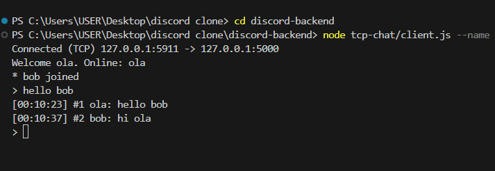{width=65%}

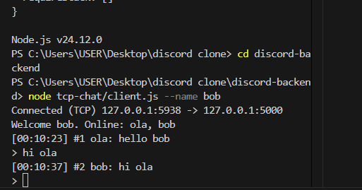{width=65%}

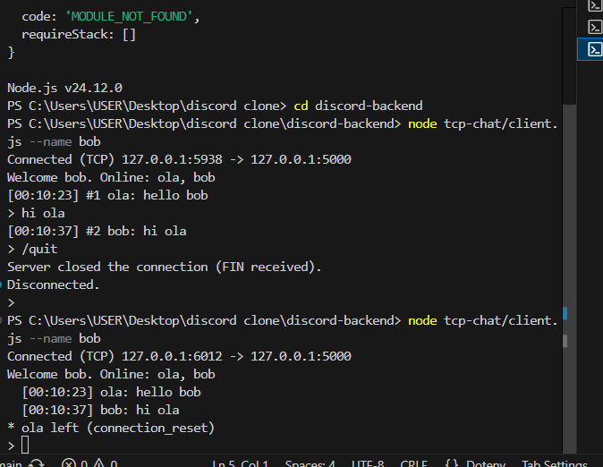{width=65%}

## 5.3 Experiment 1 — Connection establishment

**Setup:** server and client on my laptop. Wireshark on the loopback adapter, filter
`tcp.port == 5000`.

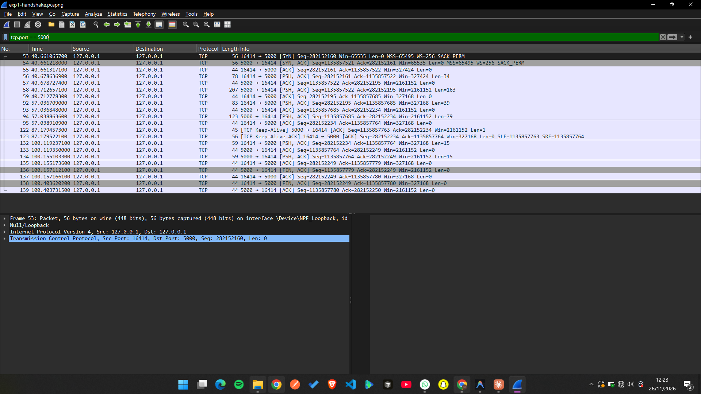{width=100%}

| Pkt | From → To | Flags | Seq | Ack |
|---|---|---|---|---|
| 53 | 16414 → 5000 | **SYN** | 282152160 | 0 |
| 54 | 5000 → 16414 | **SYN, ACK** | 1135857521 | 282152161 |
| 55 | 16414 → 5000 | **ACK** | 282152161 | 1135857522 |

**Explanation:**

- The client picked a random starting sequence number, 282152160.
- The server replied with its own random number and acknowledged the client's number **+1**.
- The client confirmed with the server's number **+1**. The connection is now open.

The SYN also agreed options: maximum segment size 65495, window scale ×256, and SACK.

Packet 56 carries the `hello` message: **34 bytes = 33 characters + 1 newline**. That is my
framing, visible on the wire. Packets 122–123 are keep-alive probes sent after 30 s of silence.

## 5.4 Experiment 2 — Packet loss and retransmission

**Setup:** clumsy dropped **10%** of packets on port 5000. Windows has no `tc netem`, so I
used clumsy instead.

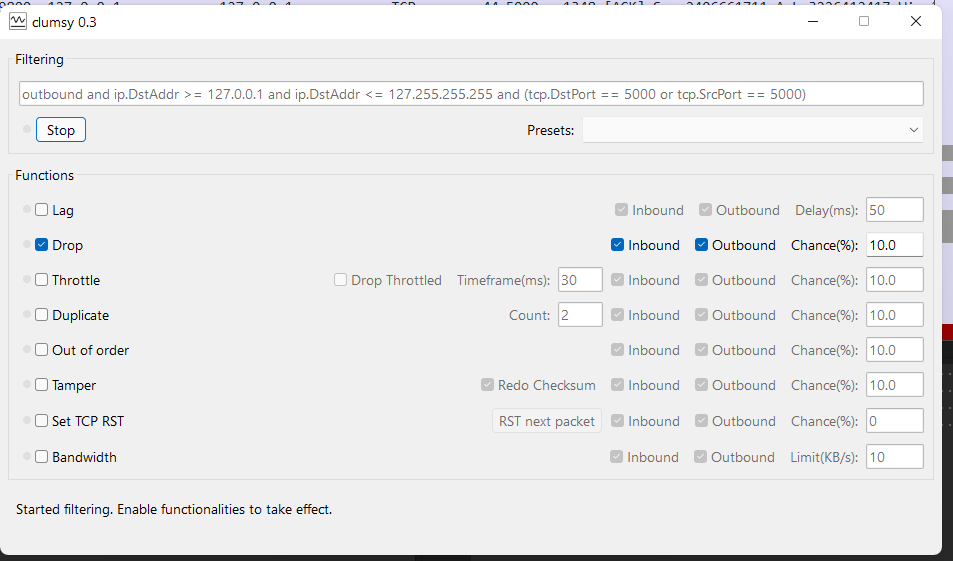{width=60%}

| | No loss | 10% loss |
|---|---|---|
| Messages delivered | 300/300 | **2000/2000, in order** |
| Average round-trip | 0.87 ms | **166 ms** |
| Worst round-trip | 4.9 ms | **8,309 ms** |

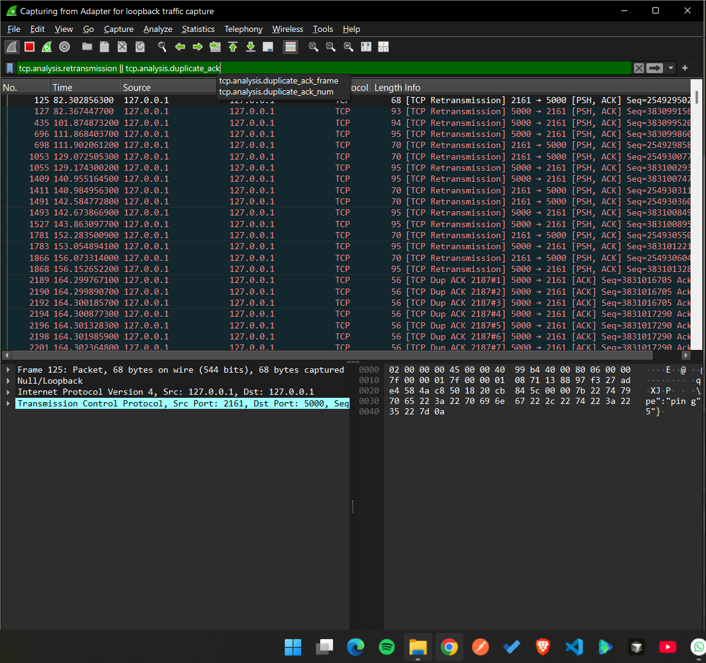{width=90%}

**Explanation:**

- **Dup ACK:** the receiver keeps asking for the missing byte.
- **Fast Retransmission:** after 3 duplicate ACKs the sender resends immediately.
- **Retransmission:** with no duplicate ACKs, the sender waits for a timeout (~300 ms), then resends.
- Packet 125 is my **ping message #5 being resent**.

TCP lost nothing; it only became slower. A late message holds up the ones behind it
(head-of-line blocking).

**Problem found:** when loss was switched on *before* connecting, connections failed
(`ETIMEDOUT`), because the lost handshake packets were not recovered in time. I added a
`--pause` option so the connection is made first and loss is switched on afterwards.

## 5.5 Experiment 3 — Connection termination

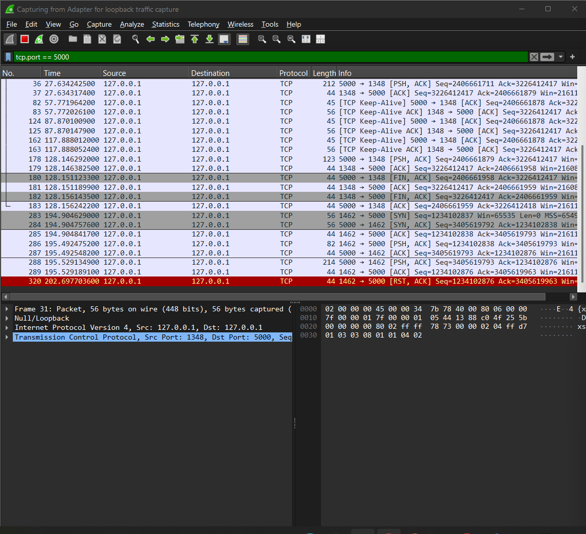{width=90%}

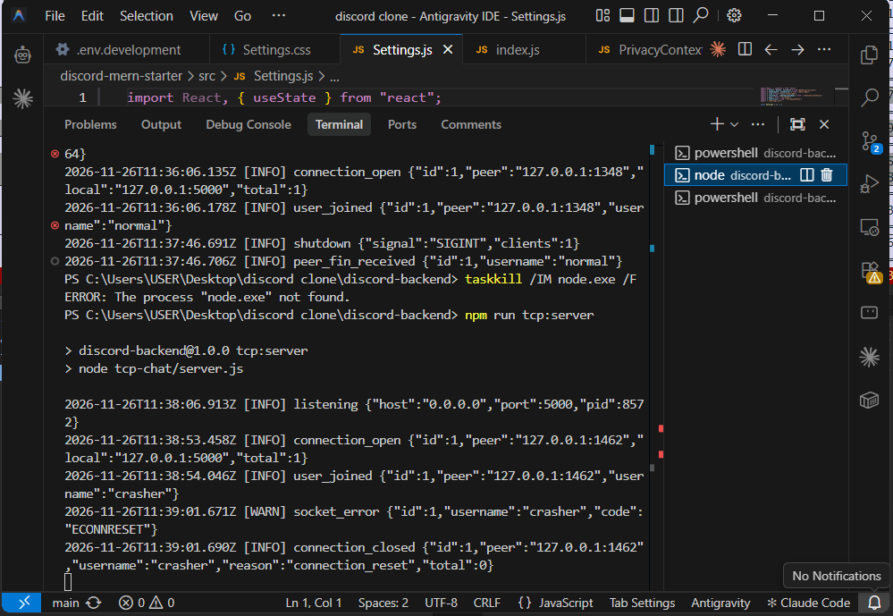{width=70%}

| | Polite close (FIN) | Crash (RST) |
|---|---|---|
| Packets | 4: FIN, ACK, FIN, ACK | 1: RST |
| Unsent data | delivered first | thrown away |
| Server log | `peer_fin_received` → `quit`/`closed` | `socket_error ECONNRESET` → `connection_reset` |
| Other users see | `left (quit)` | `left (connection_reset)` |

**Server cleanup:** in both cases the `close` handler removes the user, frees the name and tells
everyone. The user count returns to 0, so nothing is left behind.

## 5.6 Experiment 4 — Flow control and performance

| Condition | Avg RTT | Max RTT | Throughput |
|---|---|---|---|
| A — normal | 0.87 ms | 4.9 ms | 6,974 msg/s |
| B — 10% loss | 166 ms | 8,309 ms | 8,252 msg/s (all delivered) |
| Cloud (browser → Render → server) | 256 ms | — | — |

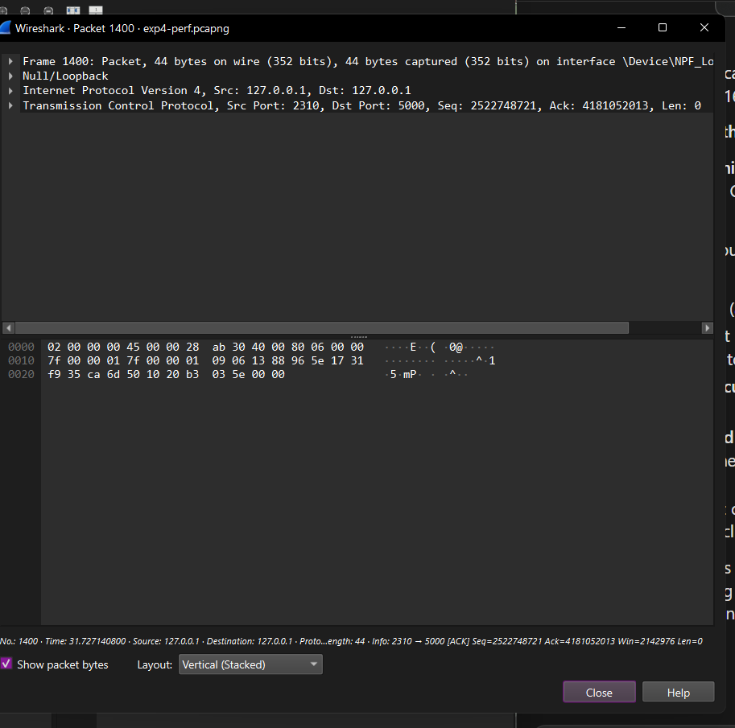{width=65%}

**Explanation:**

- The **receive window** is how much free buffer space the receiver advertises. That is **flow control**.
- Here it was about **2 MB**. It dipped slightly during a burst and recovered, and it never reached zero, so the sender was never slowed down by it.
- For chat, performance depends on **latency and loss**, not bandwidth. Loss made the average round-trip time about 190× worse.
- The cloud round trip (256 ms) shows the real Internet distance.

## 5.7 TCP versus UDP comparison

A separate tool (`tcp-chat/compare/`) sent **100 numbered messages** with each protocol, once
normally and once with 10% loss.

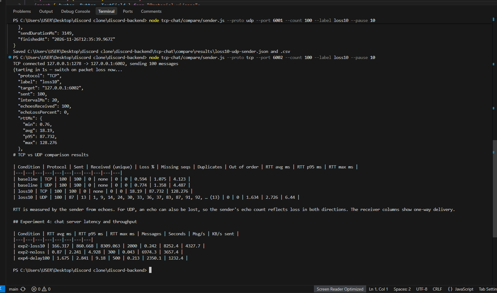{width=100%}

| Condition | Protocol | Received | Lost messages | In order | Avg RTT |
|---|---|---|---|---|---|
| Normal | TCP | 100/100 | none | yes | 0.59 ms |
| Normal | UDP | 100/100 | none | yes | 0.77 ms |
| 10% loss | TCP | **100/100** | **none** | yes | 18.2 ms |
| 10% loss | UDP | **87/100** | **1, 9, 14, 24, 30, 33, 36, 37, 83, 87, 91, 92, 98** | yes | 1.6 ms |

**Conclusion:** TCP never loses messages but becomes slower under loss. UDP stays fast but loses
data silently.

**Limits of the test:**

- clumsy's loss is random on one machine, while real networks lose packets in bursts.
- 100 messages is a small sample.
- Loopback never reorders packets, so "in order" for UDP doesn't prove UDP keeps order.

**Commands used:**

```
node tcp-chat/compare/receiver.js --proto udp --port 6001 --label baseline   (then loss10)
node tcp-chat/compare/receiver.js --proto tcp --port 6002 --label baseline   (then loss10)
node tcp-chat/compare/sender.js --proto udp --port 6001 --count 100 --label loss10 --pause 10
node tcp-chat/compare/sender.js --proto tcp --port 6002 --count 100 --label loss10 --pause 10
node tcp-chat/compare/summarize.js
```

# 6. Cloud Deployment

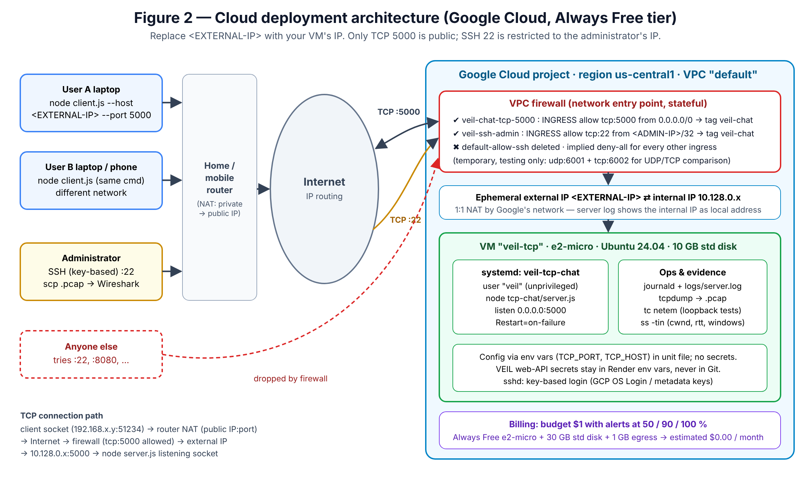{width=100%}

**Choice of provider:** Google Cloud was planned first, but account activation needed card
verification and my cards were rejected. With the lecturer's permission I used **Render**, which
also hosts my VEIL web API and has a free tier with no card.

**How it works:** Render only publishes **port 443** (HTTPS) to the public, not raw TCP port
5000. So `gateway.js` runs in front of the unchanged TCP server, in the same container:

```
browser / CLI --WebSocket over TLS (TCP 443)--> Render --> gateway.js --raw TCP--> server.js :5000
```

**WebSockets run over TCP.** They start as an HTTP request on a TCP connection, which then
carries WebSocket messages both ways. For **each user** the gateway opens a **separate TCP
connection** to the chat server, so every user is still one TCP socket to `server.js`.

**Public address:** **https://veil-tcp-chat.onrender.com**. CLI client:
`node tcp-chat/client.js --url wss://veil-tcp-chat.onrender.com/ws --name ola`

**Deployment steps:**

1. Render → New → Web Service → choose the repository.
2. Settings:
   - Branch: `claude/jolly-davinci-db5797`
   - Build command: `npm install`
   - Start command: `node tcp-chat/gateway.js`
   - Instance: Free
3. Wait for *Live* (the first deploy took 38 s).
4. **Restart:** Manual Deploy → Restart. **Stop:** Suspend. **Cleanup:** Delete Web Service.

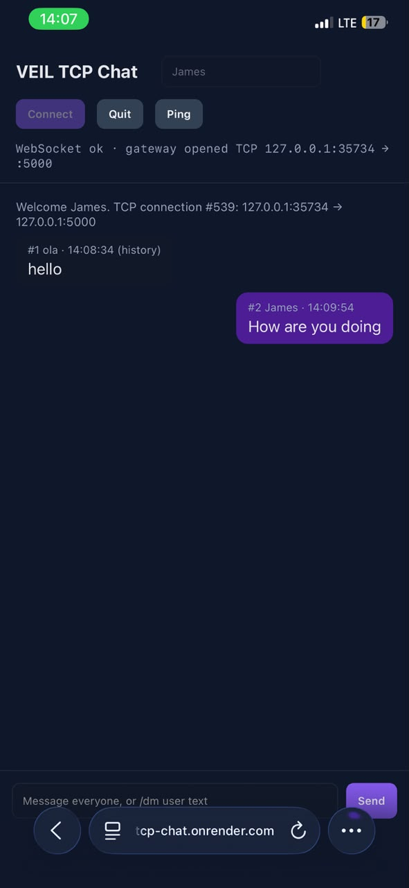{width=40%}

**Evidence:** on 26 Nov 2026, user **ola** (laptop, home Wi-Fi) and user **James** (phone,
**LTE mobile data**) chatted live through the deployed service. Ping measured **256 ms**.
The Render logs also showed Render's own internal probes sending non-JSON data to port 5000;
my server rejected each one as `malformed` and never crashed.

**Security:**

- Only port 443 is public. Port 5000 is bound to `127.0.0.1` inside the container. There is no SSH; administration is through the Render dashboard only.
- **TLS:** yes, `https://`/`wss://` with Render's certificate. **Limitation:** TLS ends at Render's edge. The local raw-TCP mode used for the experiments is unencrypted on purpose, so the packets can be read in Wireshark.
- **Secrets:** none are needed by the chat. Configuration comes from environment variables. The VEIL API's database and service keys stay in Render's environment settings, never in Git.

**Cost:** Render free instance, no card attached: **$0.00 per month**. The free instance sleeps
after ~15 minutes idle and takes up to ~50 s to wake, so I open it a minute before a demo.

# 7. Challenges and Limitations

**Challenges:**

- My original app relied on Pusher, so I had to add a real TCP layer.
- A split emoji corrupted text until I used `StringDecoder`.
- Windows has no `tc netem`, so I used clumsy, and had to switch loss on after the handshake.
- Starting the server twice gave `EADDRINUSE` (only one program can listen on a port).
- Card verification blocked Google Cloud, so I deployed on Render.

**Limitations:**

1. No login: anyone can choose any free username.
2. Messages are kept in memory and lost on restart.
3. There are no end-to-end delivery receipts.
4. The client does not reconnect automatically.
5. Packet loss was emulated on one machine with a small sample.
6. The free Render instance sleeps and has no redundancy.
7. Packet captures were taken locally, because Render does not allow tcpdump.

# 8. Conclusion

The project shows the transport layer in action:

- Each user is a TCP connection identified by IP addresses and ports.
- Newline framing turns TCP's byte stream into messages.
- Polite (FIN) and abrupt (RST) disconnections are detected and cleaned up.

Wireshark captures confirmed the three-way handshake, retransmission under loss, FIN versus RST,
and flow control. The UDP comparison showed the key trade-off: **TCP gives reliability at the
cost of delay; UDP gives speed at the cost of lost data**. That makes TCP the right choice for
chat text. The application runs publicly at no cost on Render.

# References

1. RFC 9293, *Transmission Control Protocol (TCP)*, IETF, 2022.
2. RFC 768, *User Datagram Protocol*, IETF, 1980.
3. RFC 6455, *The WebSocket Protocol*, IETF, 2011.
4. J. F. Kurose, K. W. Ross, *Computer Networking: A Top-Down Approach*, 8th ed., Pearson, 2021, ch. 3.
5. Node.js documentation, `net` and `dgram` modules, https://nodejs.org/api/
6. Wireshark User's Guide, https://www.wireshark.org/docs/ ; clumsy, https://jagt.github.io/clumsy/
7. Render documentation, https://render.com/docs

# Appendix — Key commands and files

```
npm run tcp:test                                    # 14 automated tests
npm run tcp:server                                  # TCP server on port 5000
node tcp-chat/client.js --name ola                  # raw TCP client
node tcp-chat/client.js --url wss://veil-tcp-chat.onrender.com/ws --name ola   # cloud
node tcp-chat/bench.js --label exp2-loss10 --pings 500 --messages 2000 --pause 15
```

Wireshark filters: `tcp.port == 5000`, `tcp.analysis.retransmission || tcp.analysis.duplicate_ack`.
Packet captures: `exp1-handshake.pcapng`, `exp2-loss.pcapng`, `exp3-crash.pcapng`,
`exp4-perf.pcapng`. Raw results: `tcp-chat/compare/results/`. Full test log: `docs/TEST_LOG.md`.
Detailed long version of this report: `docs/REPORT_FULL.pdf`.
